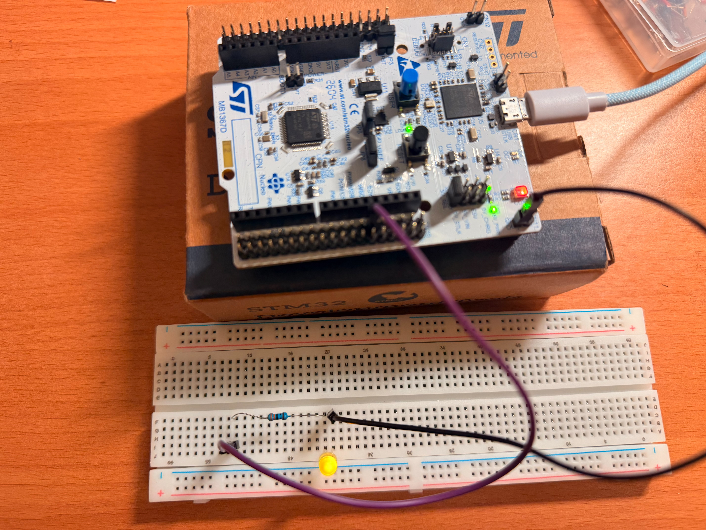
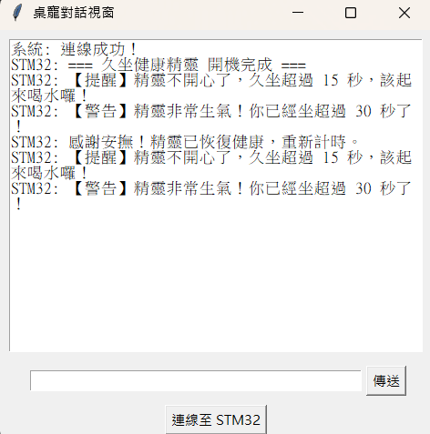

# 久坐健康精靈 (Sedentary Desk Pet) (NUCLEO-G474RE 期中專題)
透過呼吸燈與終端機文字，陪伴並提醒你該起來喝水走動的桌上小精靈。

## 1. 情境故事
身為軟體工程師，常常一寫程式就坐在電腦前好幾個小時，忘記喝水也忘記起身，導致腰痠背痛。我需要一個能放在螢幕旁邊的「實體小精靈」，它會默默幫我計時，當我坐太久時會生氣抗議，只有我站起來摸摸它（按按鍵），它才會恢復開心。

## 2. 替身對照
- 精靈的心情指示燈 → 外接麵包板 LED (接 PA5)
- 摸摸精靈的頭（安撫打卡） → 開發板內建藍色按鍵 (PC13)
- 精靈開口說話的嘴巴 → 終端機序列埠 UART (PA2 / PA3)

## 3. 功能與驗收條件
- **動作**：開機不按按鍵等待超過 15 秒。**預期/實測結果**：LED 從慢速呼吸變為快速呼吸，終端機印出「【提醒】精靈不開心了...」。
- **動作**：繼續等待超過 30 秒。**預期/實測結果**：LED 變成急促狂閃，終端機印出「【警告】精靈非常生氣...」。
- **動作**：在任何時刻按下藍色按鍵。**預期/實測結果**：LED 瞬間恢復極慢速的健康呼吸狀態，終端機印出「感謝安撫！精靈已恢復健康...」，且秒數重新計算。

## 4. 用到的技術
- 純底層暫存器 (Bare-metal Register) 開發（禁用 HAL 庫）
- 系統時脈設定 (PLL 升頻至 170MHz)
- GPIO (輸入與輸出配置)
- EXTI (外部中斷與快進快出紀律)
- Timer Timebase (Timer 3 秒數計時中斷)
- Timer PWM (Timer 2 改變佔空比呈現呼吸燈)
- UART (LPUART1 非同步傳輸，自建底層輪詢發送函式)

## 5. 腳位表
- **PA5**：TIM2_CH1，產生 PWM 訊號控制外接 LED 呼吸燈。
- **PC13**：GPIO_EXTI13，配置為下降緣觸發的外部中斷，作為安撫精靈的打卡按鍵。
- **PA2**：LPUART1_TX，精靈發送文字訊息到電腦端的發送腳。
- **PA3**：LPUART1_RX，精靈接收指令的接收腳（本專案暫未用到接收）。

## 6. 建置與執行
- **開發環境**：STM32CubeIDE 1.13.0+, STM32CubeMX。
- **燒錄步驟**：編譯確認 0 errors 後，透過 USB 連接 NUCLEO 開發板，點擊 IDE 的 Run (綠色播放鍵) 進行燒錄。
- **終端機設定**：開啟 TeraTerm 或 PuTTY，Baud Rate 設為 `115200`，Data bits: `8`，Stop bits: `1`，Parity: `None`，**Flow Control (流量控制) 務必設為 `None`**。
- **執行操作**：燒錄後按下開發板的黑色 Reset 鍵，看到終端機印出開機字串即代表啟動成功，接著只需觀察燈光並適時按下藍色按鍵即可。

## 7. 程式結構
- **main.c**：包含所有硬體初始化與主要邏輯。
- **ISR (中斷服務常式)**：
  - `TIM3_IRQHandler`：專門負責每秒將 `sedentary_sec` 變數加 1，不處理其他邏輯。
  - `EXTI15_10_IRQHandler`：負責在按鍵按下時，將秒數歸零並立下 `checkin_flag` 旗標。
- **主迴圈 (while)**：負責檢查旗標來重置狀態、根據秒數切換健康/警告/生氣狀態，並動態調整 Timer 2 的 CCR 暫存器步伐，實現平滑的呼吸燈動畫。

## 8. 實作照片

> 實作照片說明：接線時 PA2 與 PA3 需與 USB-to-TTL 模組交叉接線，外接 LED 需串聯保護電阻。
> 
> UART介面說明：顯示系統連線狀態以及提醒和警告用戶久坐。

## 9. AI 使用說明
- **使用段落**：Timer PWM 動態調速邏輯、純暫存器 UART 傳送函式撰寫。
- **查核方式**：AI 提供的 `Set_LED_Speed` 函式在動態改變 ARR 時會造成硬體死機陷阱，經實際燒錄測試發現 LED 卡死後，引導 AI 放棄修改 ARR，改為純粹改變 CCR 掃描步伐，確認運作流暢才採用。

## 10. 已知限制
- **替身與真實硬體的差異**：目前使用實體按鈕代表「摸頭」，未來若要換成真貨，需要改用電容式觸控感測模組 (Capacitive Touch Sensor)。
- **時間比例**：為了方便 Demo 驗收，目前將久坐門檻壓縮在 15 秒與 30 秒；若要實際應用，需將程式內的判斷條件改回 1800 秒 (30分鐘) 與 3000 秒 (50分鐘)。
